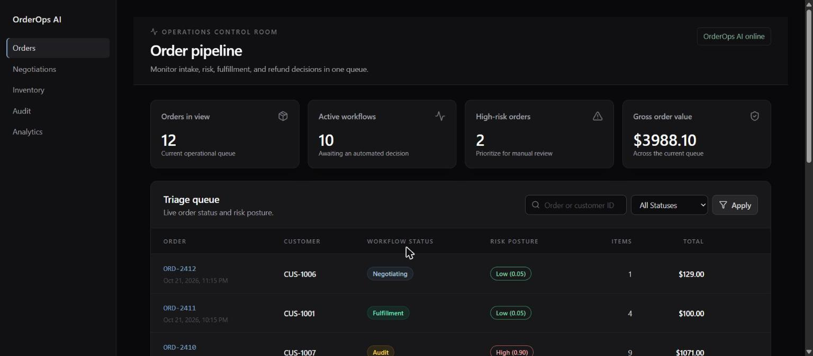

# OrderOps AI

Monorepo for the autonomous order triage & resolution agent (BRD).



## Setup (first time)

Requires **Node.js 22+** and **Python 3.12–3.14**.

```bash
# Node deps (root + frontend + backend runner)
npm install
npm run install:all

# Python deps in a virtualenv (run-dev.js picks up backend/.venv automatically)
cd backend
python -m venv .venv
.venv/Scripts/pip install -r requirements-dev.txt   # macOS/Linux: .venv/bin/pip
cd ..

# Environment files — copy the examples, then set a real SECRET_KEY and ADMIN_PASSWORD
cp backend/.env.example backend/.env
cp frontend/.env.example frontend/.env.local
```

Needs a running **PostgreSQL** reachable at `DATABASE_URL` with an `orderops` database:
either `docker compose up -d db` (matches the default URL) or your own install plus `createdb orderops`. Tables are created and filled with demo data on first start.

On first start the API creates an admin account from `ADMIN_EMAIL` / `ADMIN_PASSWORD` in `backend/.env` (skipped while the password is empty).
Sign in with it, then add other users on the **Users** page. Changing these two settings later has no effect: manage accounts on the Users page.

### Roles

| Role | Can do |
|---|---|
| admin | Everything, including managing users and reading the audit trail (Activity log) |
| operator | View everything, create orders, accept/decline negotiation offers |
| reviewer | View everything, approve/reject orders in the audit queue |
| analyst | View everything, change nothing |
| customer | Linked to one customer ID: view and place only that customer's orders and answer its offers. Fraud scores and notes are hidden. |

The API enforces every rule (`backend/app/core/permissions.py`); the dashboard only hides what a role can't use.
Signing out revokes the token on the server, as does a password change or deactivation.

Every sign-in, order, decision, account change and refused attempt goes into an append-only, hash-chained **audit trail**
(who, what changed, when, outcome, order ID). Logs are scrubbed of tokens, passwords and email addresses. See
[docs/architecture.md](docs/architecture.md#audit-trail).

## Run together (one command)

From the project root:

```bash
npm run dev
```

This starts **FastAPI** and **Next.js** together in development mode (auto-reload; each page compiles on first visit).
For a fast, production-like run, use `npm start` instead: it builds the frontend once, then every page loads instantly.

Sessions sign out after **15 minutes** without activity (`IDLE_TIMEOUT_SECONDS` in `frontend/src/lib/session.ts`).

| App | URL |
|-----|-----|
| Frontend + API (proxied) | http://127.0.0.1:3000 |
| FastAPI direct | http://127.0.0.1:8000 |
| Swagger docs | http://127.0.0.1:8000/docs |

Frontend calls go to `/api/v1/...` and `/health` on port **3000**; Next.js proxies them to FastAPI on **8000**.

## Repository layout

```
.
├── backend/               # FastAPI + LangGraph API (see backend/README.md)
├── frontend/              # Next.js ops dashboard (see frontend/README.md)
├── .github/               # CI: lint, tests against Postgres, type-check, unit + browser tests, build
├── docs/                  # Architecture, database schema, API, threat model, runbook
├── docker-compose.yml     # Full stack (db + backend + frontend), or just the db for local dev
├── SECURITY.md            # Vulnerability reporting + deployment checklist
└── package.json           # `npm run dev` starts both apps together
```

## Projects

| Folder | Role | Stack |
|--------|------|--------|
| `backend/` | API, LangGraph agent, DB | FastAPI, LangGraph, SQLAlchemy, PostgreSQL |
| `frontend/` | Ops dashboard | Next.js, TypeScript |

## BRD workflow

Order intake → fraud check → inventory validation → (negotiate if OOS) → fulfill / refund / audit

`POST /api/v1/orders/intake` runs the LangGraph triage graph (`backend/app/agents/graph.py`):

- **Fraud check:** rule-based score (order value, first order, velocity, bulk quantity). A score of 0.75 or higher goes to the manual **audit** queue.
- **Inventory check:** every line in stock → stock is reserved → **fulfillment**.
- **Out of stock:** a same-category alternative at the closest price is offered at 10% off → **negotiating**. With no alternative → **refunded**.
- **Customer reply** (`POST /api/v1/negotiations/{id}/respond`): accepted → item swapped, discounted, fulfilled. Declined → refunded.

## Run in Docker

```bash
cp backend/.env.example backend/.env    # set SECRET_KEY and ADMIN_PASSWORD
docker compose up --build               # → http://localhost:3000
```

## Docs

[Architecture](docs/architecture.md) · [Database schema](docs/database-schema.md) · [API](docs/api.md) ·
[Threat model](docs/threat-model.md) · [Runbook](docs/runbook.md)

## Tests & lint

```bash
cd backend && .venv/Scripts/python -m pytest -q && .venv/Scripts/python -m ruff check .
cd frontend && npm run lint && npx tsc --noEmit && npm test
cd frontend && npx playwright install chromium && npm run test:e2e   # browser tests, starts its own servers
```

CI runs all of these plus a production build on every push.

Tests never touch your dev data: backend tests use `orderops_test`, browser tests use `orderops_e2e` (both recreated
automatically) and run on ports 3001/8001. The browser tests do replace `frontend/.next` with a production build.

## License

[MIT](LICENSE)
